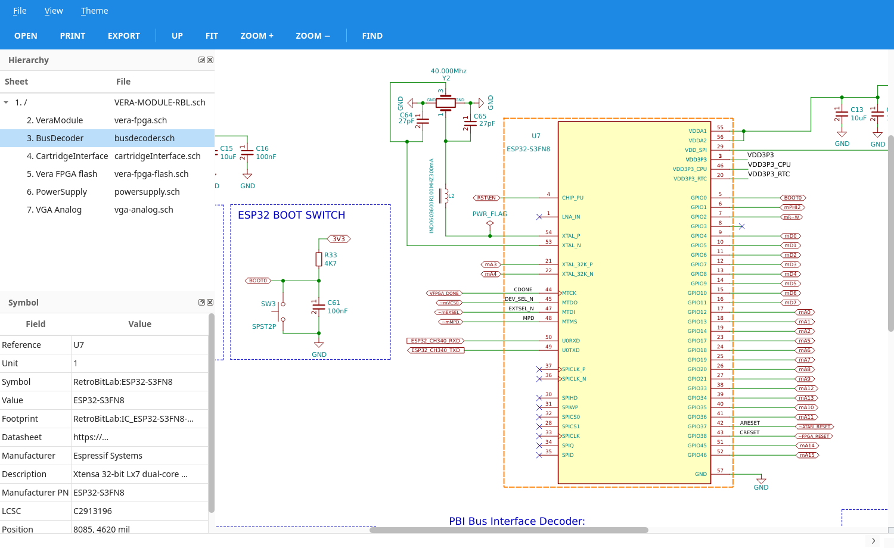
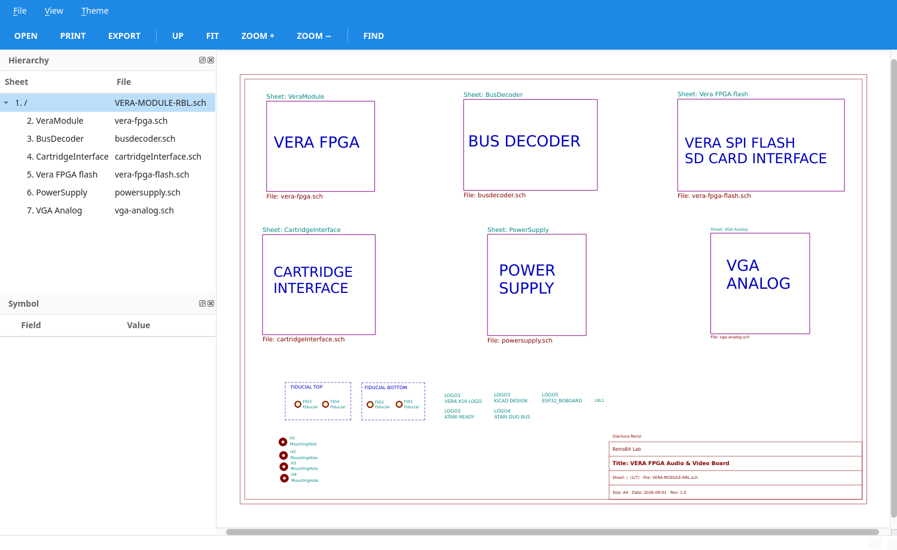
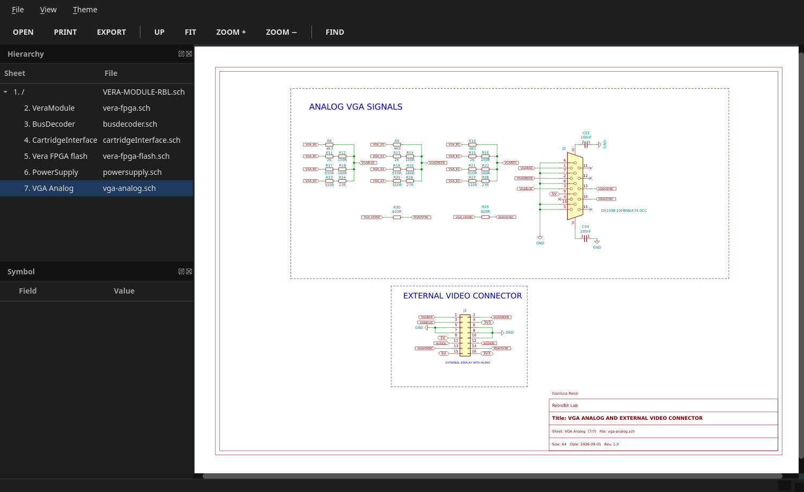
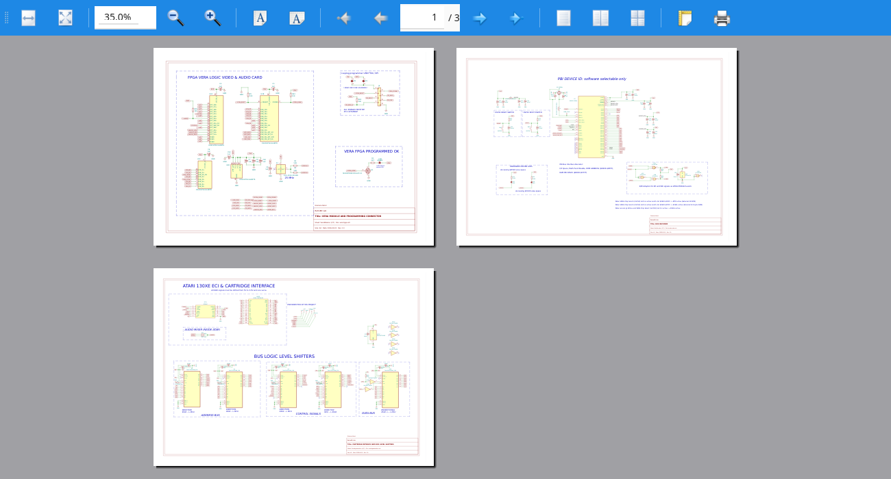
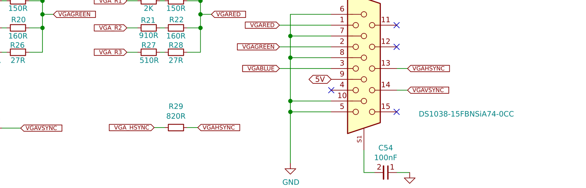

<p align="center">
  
</p>

<h1 align="center">KeSeV</h1>

<p align="center">
  <b>the <u>K</u>iCad <u>S</u>chematic <u>V</u>iewer</b> &nbsp;·&nbsp; say it <i>"keh-sev"</i><br>
  open any KiCad schematic, from KiCad 4 to KiCad 9, without installing KiCad
</p>

<p align="center">
  
  
  
  
  
</p>

---

KeSeV is a fast, read-only viewer for KiCad schematics. Point it at the root
sheet and walk the whole hierarchy, click a symbol to read its fields, find a
reference across every sheet, print the sheets you want or export them to
PNG, PDF and SVG. It is a single Python file plus its fonts: no KiCad, no
symbol libraries to install, no build step.

## Highlights

- **Every KiCad version.** KiCad 4/5 `.sch` with the legacy `.lib` libraries
  (the project cache is found by itself) and KiCad 6, 7, 8, 9 and later
  `.kicad_sch`, whose symbols travel inside the file.
- **The whole hierarchy.** A tree of all sheets; double-click a sheet box to
  step in, `Backspace` to step out. Sheets used more than once show the right
  references for each instance.
- **Looks like KiCad.** KiCad's colours, symbol orientations and mirrors, pin
  shapes, names and numbers, field placement, global / hierarchical labels,
  junctions, no-connects, text boxes, sheet colours, embedded images,
  "do not populate" marks and the title block.
- **Inspect.** Click a symbol: reference, value, footprint, datasheet and every
  custom field (LCSC, manufacturer, ...) in the side panel; hover for a tip.
- **Find.** `Ctrl+F` searches references, values and labels in all sheets;
  `F3` jumps to the next hit.
- **Print.** All sheets, the current one, a range, or the sheets you pick in
  the tree; one sheet per page, scaled to fit, with print preview.
- **Export.** PNG, PDF (page size of the sheet) and SVG, from the window or
  from the command line for scripts and CI.
- **Material look.** Light and dark Material themes (or the system look),
  remembered between runs.
- **Self-contained.** The fonts ship with the program, the settings live next
  to it; the only dependency is PyQt5.

## Screenshots

| | |
|:---:|:---:|
|  |  |
| The hierarchy: every sheet one click away | Material dark theme |
|  |  |
| Print preview: all, current, range or selected sheets | A detail of a PNG export |

<sub>The screenshots show the schematics of the
<a href="https://github.com/gianlucarenzi/Vera-Module-RBL-C64">VERA Module RBL-C64</a>
(KiCad 5).</sub>

## Quick start

```sh
git clone https://github.com/gianlucarenzi/kicad-sch-viewer.git
cd kicad-sch-viewer
./kesev ~/my-board/my-board.kicad_sch        # KiCad 6+
./kesev ~/old-board/old-board.sch            # KiCad 4/5
```

Want it on your `PATH`? `ln -s "$PWD/kesev" ~/bin/kesev` (the program finds
its fonts through the link).

## Installing PyQt5 on Debian / Ubuntu

```sh
sudo apt update
sudo apt install python3 python3-pyqt5 python3-pyqt5.qtsvg \
                 libqt5printsupport5 libqt5gui5 libqt5svg5
```

| Package | Gives KeSeV |
|---|---|
| `python3-pyqt5` | QtCore, QtGui, QtWidgets and QtPrintSupport: the window, the drawing, the print dialog, print preview and PDF export |
| `libqt5printsupport5` | Qt's print support with the CUPS plugin (`qt5/plugins/printsupport/libcupsprintersupport.so`): the system printers in the print dialog |
| `libqt5gui5` | the platform plugins: `xcb` (the window on X11 / XWayland) and `offscreen` (`--export` without a display) |
| `python3-pyqt5.qtsvg`, `libqt5svg5` | QtSvg: the SVG export (optional; PNG and PDF work without it) |

`libqt5printsupport5` and `libqt5gui5` come with `python3-pyqt5` anyway; they
are named so that nothing is left out. The printers themselves come from
CUPS, which a desktop install already has; on a minimal system:

```sh
sudo apt install cups cups-client          # the print system and its tools (lpstat, lp)
```

Optional:

```sh
sudo apt install qtwayland5                # native Wayland window (otherwise XWayland)
sudo apt install qt5-gtk-platformtheme     # GTK file dialogs with the "System" theme
```

Check the installation:

```sh
python3 -c "from PyQt5 import QtWidgets, QtPrintSupport; print('PyQt5 ok')"
python3 -c "from PyQt5 import QtSvg; print('SVG export ok')"
lpstat -p                                  # the printers the print dialog will list
```

Tested on Debian 11 (bullseye) with the distribution packages (PyQt5 5.15,
Qt 5.15).

## Command line

```sh
kesev board.kicad_sch [--theme light|dark|system]
kesev board.sch [-L extra.lib ...]                 # KiCad 4/5: extra symbol libraries
kesev board.kicad_sch --export out.png             # sheet 1 (the root)
kesev board.kicad_sch --export out.pdf --sheet 3   # sheet 3 of the hierarchy tree
kesev board.kicad_sch --export out.svg --sheet 0   # every sheet: out-1.svg, out-2.svg, ...
```

`--export` runs without a display (Qt's offscreen platform), so it works over
SSH and in CI jobs.

## Mouse and keys

| Action | How |
|---|---|
| Zoom | mouse wheel, `+` / `-` |
| Pan | drag with the left or middle button |
| Fit the page | `Home` or `F` |
| Symbol fields | click the symbol (hover: tooltip) |
| Open a sheet | double-click its box, or click it in the tree |
| Parent sheet | `Backspace` or `Alt+Left` |
| Find / next | `Ctrl+F` / `F3` |
| Export the sheet | `Ctrl+E` |
| Print / preview | `Ctrl+P` / `Ctrl+Shift+P` |
| Select sheets to print | `Ctrl`/`Shift` + click in the tree, then Print → Selection |
| Open a schematic | `Ctrl+O` |

## Formats

| KiCad | File | Symbols from | Status |
|---|---|---|---|
| 4, 5 | `.sch` (EESchema format 2–4) | `*-cache.lib`, `*-rescue.lib`, the `.pro` libraries, `-L` | tested |
| 6 | `.kicad_sch` (2021) | inside the file | from the format description |
| 7 | `.kicad_sch` (2023) | inside the file | from the format description |
| 8 | `.kicad_sch` (20231120) | inside the file | from the format description |
| 9 | `.kicad_sch` (20250114) | inside the file | tested |
| 10 and later | `.kicad_sch` | inside the file | unknown items are skipped, the rest is drawn |

KiCad 6+ text markup is understood: `~{...}` overbars, `_{...}` / `^{...}`,
and `${VARIABLES}` from the title block, the project's `.kicad_pro` and the
symbol's own fields.

## Known approximations

- Texts use DejaVu Sans, not KiCad's stroke font or the TrueType fonts picked
  in KiCad 7+.
- Global label outlines are simplified; the title block has a fixed layout
  (custom `.kicad_wks` drawing sheets are not read).
- KiCad 4/5 Bézier curves are drawn as their control polygon and `$Bitmap`
  images are skipped.
- KiCad 8+ tables, rule areas and net class flags are not drawn.

## What is in the box

| Path | What |
|---|---|
| `kesev` | the program (one Python file) |
| `fonts/` | DejaVu Sans (the schematic texts) and Noto Sans (the window), with their licences |
| `docs/screenshots/` | the pictures of this page |
| `kesev.ini` | the settings (the theme), written next to the program on the first change |

## Licence

KeSeV is free software under the GNU General Public License version 3 or
later (`LICENSE`). The fonts keep their own licences: DejaVu (Bitstream Vera
licence, `fonts/LICENSE-DejaVu.txt`), Noto Sans (SIL Open Font License 1.1,
`fonts/LICENSE-Noto.txt`).
